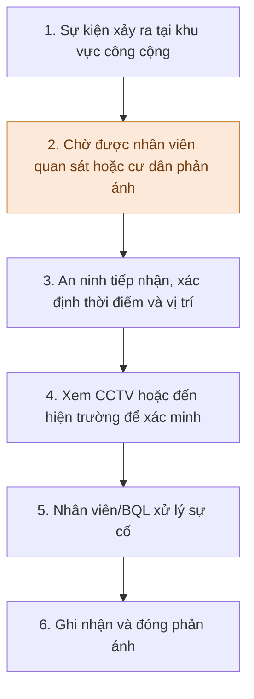
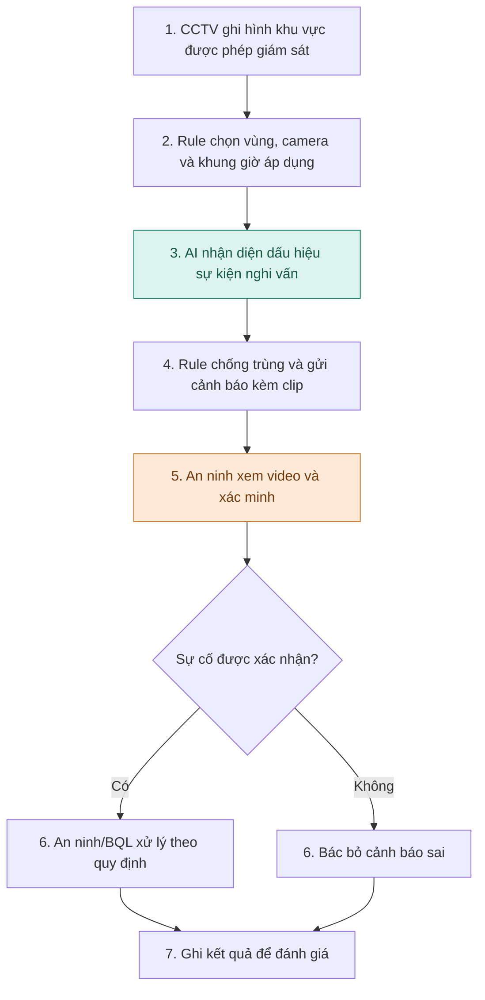

# Báo cáo nhóm — Day 02 Discovery & Problem Framing

> Repo nhóm MALTO · K5-L3B

## 1. Thông tin nhóm

- **Tên nhóm:** MALTO
- **Thành viên:** Xem `TEAM.md`.
- **Candidate problem được chọn:** Hỗ trợ BQL khu đô thị phát hiện sớm dấu hiệu thú cưng phóng uế, chó không rọ mõm tại khu vực bắt buộc và hành vi gây thương tích bằng cảnh báo từ CCTV để nhân viên xác minh, xử lý.
- **Giải pháp đang đề xuất:** Computer Vision phát hiện sự kiện nghi vấn → gửi cảnh báo kèm video → an ninh/BQL xác minh và xử lý; không truy vết chủ sở hữu hoặc xác định căn hộ.
- **Quyết định sơ bộ:** **Not Yet** cho triển khai rộng; **Go có điều kiện** cho thử nghiệm khả thi quy mô nhỏ, nếu có video hợp lệ và được cấp phép.

---

## 2. Hội tụ nhóm (CP3)

### 2.1. Pitch

Đã nhận **đủ bốn báo cáo cá nhân** của Nguyễn Xuân Khánh Linh, Đậu Hoàng Minh, Đặng Minh Thu và Lê Thế Anh. Bảng dưới tổng hợp **12 candidate từ ba Problem Cards ưu tiên của mỗi thành viên**, không còn chờ báo cáo cá nhân. Việc **trực tiếp trình bày trước nhóm** chưa được xác nhận cho tất cả các dòng; kiểm tra biên bản buổi họp trước khi dùng bảng này như nhật ký pitch chính thức.

| # | Người đưa ra | Candidate (Job Story ngắn) | Actor | Bottleneck | Câu hỏi phản biện nhận được (ai hỏi) |
|---:|---|---|---|---|---|
| 1 | Nguyễn Xuân Khánh Linh | Khi creative đã bàn giao, muốn biết task nào chưa được test và lý do chờ để tránh bỏ sót | UA, Creative | Task `waiting` chưa được phân biệt giữa chờ chủ động và quá hạn | **Đậu Hoàng Minh hỏi** liệu problem đã có công cụ sẵn có giải quyết chưa (chưa xác nhận câu hỏi nhắm chính xác card nào) |
| 2 | Nguyễn Xuân Khánh Linh | Khi thiết lập ads scenario, muốn giảm thao tác gán remote key lặp lại giữa nhiều game | Monetization | Lặp lại thao tác cấu hình và kiểm tra key/value | Chưa có câu hỏi được xác nhận |
| 3 | Nguyễn Xuân Khánh Linh | Khi chấm IELTS Writing, muốn có câu sửa phù hợp comment và phong cách sửa của giáo viên | Giáo viên IELTS | Giáo viên tự diễn đạt câu sửa mẫu cho từng nhận xét | Chưa có câu hỏi được xác nhận |
| 4 | Đậu Hoàng Minh | Khi kết thúc cuộc họp, muốn có quyết định, action item, owner và deadline rõ ràng | Người chủ trì và thành viên nhóm | Lọc action item từ ghi chú và viết biên bản thủ công | Được hỏi: “Công ty có cho ghi âm họp không?” (chưa rõ người hỏi) |
| 5 | Đậu Hoàng Minh | Khi có nhiều email/tin nhắn, muốn xác định tin quan trọng và deadline để không bỏ sót | Nhân viên văn phòng | Đọc và phân loại thông tin đa kênh | Chưa có câu hỏi được xác nhận |
| 6 | Đậu Hoàng Minh | Khi đi công tác về, muốn chuẩn bị chứng từ đầy đủ để hồ sơ không bị trả lại | Nhân viên, kế toán | Gom hóa đơn và đối chiếu quy định | Chưa có câu hỏi được xác nhận |
| 7 | Đặng Minh Thu | Khi có sự cố thú cưng, muốn phát hiện và xử lý kịp thời để bảo đảm vệ sinh/an toàn | BQL, an ninh, cư dân | Phát hiện chậm, tìm CCTV và xác minh thủ công (giả thuyết ban đầu) | Chưa có câu hỏi được xác nhận |
| 8 | Đặng Minh Thu | Khi nghe bài giảng, muốn ghi chú có cấu trúc và hỏi đáp riêng tư để không mất mạch học | Học viên, giáo viên | Nghe, ghi chép, tra cứu đồng thời | Chưa có câu hỏi được xác nhận |
| 9 | Đặng Minh Thu | Khi nhận yêu cầu qua email/chat/ticket, muốn phân loại ưu tiên và chuyển đúng người | Nhân viên xử lý yêu cầu | Đọc, tổng hợp, phân loại nhiều kênh | Chưa có câu hỏi được xác nhận |
| 10 | Lê Thế Anh | Khi xảy ra sự cố thú cưng, muốn xác minh nhanh để BQL xử lý | BQL, an ninh, cư dân | Chưa rõ độ trễ phát hiện và công sức xác minh CCTV | Có chuẩn bị câu hỏi về nhận diện sai và khác biệt nội quy giữa tòa nhà; chưa xác nhận đã được hỏi trực tiếp |
| 11 | Lê Thế Anh | Khi căn tin đông, muốn biết thời gian chờ/suất còn lại để chủ động ăn trưa | Học viên, căn tin | Xếp hàng khoảng 15–20 phút theo trải nghiệm cá nhân | Chưa có câu hỏi được xác nhận |
| 12 | Lê Thế Anh | Khi đi xe buýt cao điểm, muốn biết xe đến có còn đón khách được không | Hành khách | Chỉ biết xe đã đầy khi đến trạm; có lần phải đợi thêm khoảng 20 phút | Chưa có câu hỏi được xác nhận |

**Nhận xét từ thảo luận:** Minh ghi rằng card tóm tắt sau họp bị loại khỏi shortlist cuối vì đã có nhiều công cụ tương tự; Linh ghi mình lập bảng tiêu chí để giúp nhóm chọn; Thế Anh và Thu có candidate cùng domain thú cưng. Hai candidate thú cưng ở #7 và #10 được gộp thành một hướng bài toán khi hội tụ.

### 2.2. Cluster

| Cluster | Các candidate | Pattern chung |
|---|---|---|
| A — Phát hiện chậm / giám sát tình trạng | Creative waiting (#1); sự cố thú cưng (#7, #10); thông tin xe buýt đầy (#12) | Người dùng chỉ biết sự kiện/rủi ro khi đã muộn; cần nhìn thấy tình trạng kịp thời |
| B — Xử lý tác vụ lặp lại và quy trình | Remote key (#2); biên bản cuộc họp (#4); hồ sơ công tác phí (#6); tình trạng căn tin (#11) | Có những bước lặp lại hoặc thiếu quy trình/định dạng thông tin thống nhất |
| C — Hiểu và tổng hợp thông tin đa nguồn | IELTS Writing (#3); email/tin nhắn (#5); ghi chú bài giảng (#8); phân loại yêu cầu đa kênh (#9) | Phải đọc/hiểu ngữ cảnh, phân loại hoặc chuyển thông tin sang dạng dễ hành động |

### 2.3. Opportunity Solution Tree rút gọn

```text
OUTCOME: Giảm thời gian từ khi sự cố thú cưng xuất hiện đến khi BQL/an ninh
         biết và bắt đầu xác minh/xử lý, không làm nhân viên quá tải cảnh báo.
├── Opportunity A: Sự cố tại khu vực chung có thể không được ai nhận biết ngay.
├── Opportunity B: Nhân viên không thể liên tục quan sát nhiều luồng CCTV.
└── Opportunity C: Khi có sự cố nghi vấn, nhân viên cần đủ video, thời điểm,
                   camera và vị trí để xác minh nhanh, tránh báo nhầm.
```

**Những ý loại khỏi tầng opportunity vì là solution:** “Xây AI Computer Vision”, “Xây ứng dụng gửi push notification”, “Tự truy vết căn hộ”. Đây là phương án giải quyết (hoặc hướng đã bị loại), không phải nhu cầu/pain.

### 2.4. Chấm điểm shortlist (1–5)

**Phương pháp:** Đánh giá đề xuất của AI dựa trên bốn báo cáo cá nhân, theo 7 tiêu chí của lab. Mỗi tiêu chí từ **1 (yếu) đến 5 (mạnh)**, các tiêu chí có trọng số bằng nhau, tổng tối đa **35 điểm**. Điểm này **không phải biên bản chấm hay biểu quyết thực tế của nhóm**; nhóm cần rà lại nếu có thống nhất khác.

| Candidate | Actor rõ | Quy trình rõ | Pain có bằng chứng | Impact đo được | Vừa sức lab | So sánh được No AI/Rule/Workflow/Agent | Nhóm hiểu domain | Tổng /35 |
|---|---:|---:|---:|---:|---:|---:|---:|---:|
| Cảnh báo sớm sự cố thú cưng | 5 | 4 | 2 | 3 | 3 | 5 | 3 | **25** |
| Creative chờ test (Linh) | 5 | 4 | 4 | 4 | 4 | 5 | 5 | **31** |
| Biên bản / action item sau cuộc họp (Minh) | 5 | 5 | 4 | 4 | 5 | 5 | 5 | **33** |

**Giải thích điểm số:**

- **Cảnh báo sớm sự cố thú cưng (25/35):** Actor BQL/an ninh rõ; có thể phác thảo workflow phát hiện → cảnh báo → xác minh. Tuy nhiên, bằng chứng pain hiện mới là lời kể một cư dân, **0 phỏng vấn/0 khảo sát**, chưa có số liệu tần suất hoặc độ trễ phát hiện; chưa tiếp cận CCTV để kiểm thử, và nhóm chưa có hiểu biết vận hành trực tiếp từ BQL. Impact có thể đo bằng detection latency và tỷ lệ cảnh báo sai nhưng chưa có baseline.
- **Creative chờ test (31/35):** Có log **109/235 task đang `waiting`**, nên bằng chứng tồn đọng mạnh hơn; quy trình UA–Creative và actor rõ, nhóm có hiểu biết thực tế về domain game. Điểm chưa chắc: `waiting` không đồng nghĩa với bị bỏ sót, nguyên nhân và thời gian xử lý thủ công chưa được xác minh. Có thể thử Rule/Workflow trước khi dùng AI.
- **Biên bản cuộc họp (33/35):** Có trải nghiệm **4–5 cuộc họp/tuần**, ước tính **15–30 phút/cuộc** để viết biên bản; workflow và metric đơn giản, dễ kiểm thử bằng ghi chú/transcript được phép sử dụng. Điểm trừ là số liệu chủ yếu từ trải nghiệm cá nhân, và nhiều công cụ hiện có đã hỗ trợ tóm tắt cuộc họp.

**Diễn giải:** Điểm càng cao thể hiện bài toán càng rõ và dễ kiểm chứng **theo các tiêu chí đã cho**, không chứng minh tính mới hoặc lợi thế cạnh tranh. Bài toán biên bản cuộc họp đạt điểm cao nhất, nhưng nhóm đã chọn bài toán thú cưng để tiếp tục khám phá cơ hội ứng dụng Computer Vision cho cảnh báo hành vi. Đây là **quyết định có đánh đổi**, không phải kết quả thắng theo tổng điểm; phần thiếu bằng chứng phải được ưu tiên kiểm chứng tại CP4 và trước pilot. Chưa khẳng định giải pháp nhận diện hành vi của nhóm là mới trên toàn thị trường.

**Candidate được chọn:** Phát hiện sớm và cảnh báo dấu hiệu phóng uế, chó không rọ mõm ở nơi bắt buộc và tương tác nguy hiểm có thể gây thương tích, để BQL/an ninh xác minh và xử lý.

**Vì sao chọn:** Nhóm quan tâm tới bài toán an toàn/vệ sinh có actor rõ và cơ hội ứng dụng Computer Vision ở bước nhận diện hành vi từ video. Bài có thể tách ranh giới AI/con người và đánh giá được bằng detection latency, recall, precision, số cảnh báo sai và thời gian phản ứng. Tuy nhiên, pain còn ít bằng chứng định lượng và Feasibility cần thử trên CCTV thực tế; đây là **lựa chọn để tiếp tục kiểm chứng**, chưa phải khẳng định sẽ triển khai.

**Vì sao hai candidate khác không được chọn:**

- **Biên bản họp:** Minh có dữ liệu trực tiếp về 4–5 cuộc họp/tuần, nhưng nhóm nhận thấy có nhiều công cụ ghi chú/tóm tắt cuộc họp sẵn có. Minh mô tả mình đã ủng hộ phương án thú cưng sau khi được phản biện về mức độ khác biệt sản phẩm.
- **Creative chờ test:** Linh có số liệu backlog từ Creative Hub; nhưng cần xác minh `waiting` là bỏ sót hay chờ có chủ đích. Hướng xử lý ban đầu có thể bắt đầu từ SLA/tracking và rule trước khi dùng AI.

**Bất đồng và cách xử lý:** Theo bài cá nhân của Minh, ý tưởng tổng hợp sau họp được cân nhắc rồi không vào shortlist cuối. Nhóm chọn tập trung nghiên cứu sự cố thú cưng. Nếu buổi thảo luận có chấm điểm, biểu quyết hoặc tranh luận khác, bổ sung người tham gia và kết quả thực vào phần này trước khi nộp.

---
## 3. Kiểm chứng + research giải pháp đã có (CP4)

### 3.1. Assumption Map

Thang điểm 1–5: Quan trọng = mức độ ảnh hưởng đến quyết định; Đã có bằng chứng = mức độ chứng cứ hiện tại. Các điểm dưới đây **chỉ là tự đánh giá trước validation**.

| # | Giả định | Loại (Value / Usability / Feasibility / Viability) | Quan trọng (1–5) | Đã có bằng chứng (1–5) | Kiểm chứng trước? |
|---:|---|---|---:|---:|---|
| 1 | Phóng uế, không rọ mõm tại khu vực bắt buộc và hành vi gây thương tích xảy ra đủ thường xuyên/đủ nghiêm trọng để BQL cần cải thiện khả năng phát hiện | Value | 5 | 1 | ✅ |
| 2 | Việc giám sát hiện tại phụ thuộc nhiều vào phản ánh cư dân hoặc tuần tra, khiến một số sự cố được biết muộn/bỏ sót | Value | 5 | 1 | ✅ |
| 3 | Cảnh báo sớm kèm video giúp nhân viên phản ứng nhanh hơn mà không làm tăng quá nhiều thời gian kiểm tra cảnh báo sai | Value / Usability | 5 | 1 | ✅ |
| 4 | Camera hiện tại bao phủ đúng khu vực cần giám sát, hình ảnh đủ rõ để phân tích hành vi và chi tiết rọ mõm | Feasibility | 5 | 1 | ✅ |
| 5 | Có thể phát hiện dấu hiệu **từng loại sự kiện** với precision/recall phù hợp trên video thực tế, không chỉ phát hiện chó/mèo | Feasibility | 5 | 1 | ✅ |
| 6 | BQL có quyền và điều kiện xử lý CCTV, có nhân sự trực cảnh báo, cơ chế bảo vệ dữ liệu và quy trình xác minh | Viability | 5 | 1 | Hỏi BQL và người quản trị CCTV |

**Ưu tiên kiểm:** (1) có pain thực, (2) phát hiện chậm là bottleneck, (3) camera có quan sát được hành vi, và (4) dữ liệu/video được sử dụng hợp lệ.

3.2. Kiểm chứng
Trạng thái được nhóm cập nhật: Đại diện nhóm xác nhận đã thực hiện khảo sát với 8 phiếu trả lời và số liệu tổng hợp trùng với bảng kết quả phía dưới. Chưa có phỏng vấn có cấu trúc với BQL/an ninh. Trợ lý chưa được xem biểu mẫu hoặc dữ liệu trả lời gốc; ngày khảo sát, đối tượng trả lời và phương pháp tuyển mẫu cần nhóm điền từ hồ sơ thực tế trước khi nộp. Kết quả khảo sát được ghi nhận theo thông tin nhóm cung cấp, không phải dữ liệu do trợ lý tự kiểm chứng.

Thông tin phương pháp cần bổ sung từ hồ sơ khảo sát:
Trường	Thông tin
Số phiếu hợp lệ	8 (theo xác nhận của nhóm)
Ngày / khoảng thời gian thực hiện	[Nhóm điền từ khảo sát thật]
Hình thức thu thập (Form, hỏi trực tiếp, ...)	[Nhóm điền]
Đối tượng và cách chọn người trả lời	[Nhóm điền] — không mặc định cả 8 người đều là cư dân nếu chưa đối chiếu
Minh chứng (liên kết Form/Sheets hoặc bản tổng hợp ẩn danh)	[Nhóm bổ sung đường dẫn hoặc tên tệp]
Phỏng vấn BQL/an ninh	Chưa thực hiện


Bộ câu hỏi dùng để đối chiếu với form gốc (đây là khung câu hỏi đã chuẩn bị trong báo cáo, chưa xác nhận là nguyên văn câu hỏi nhóm thực tế đã sử dụng):
1. Trong 3 tháng gần đây, bạn đã trực tiếp chứng kiến tình huống nào tại khu vực chung? (Có thể chọn nhiều: thú cưng phóng uế; chó không đeo rọ mõm ở nơi bắt buộc; thú cưng tấn công/gây thương tích; chưa chứng kiến.)
2. Bạn đã từng gửi phản ánh về sự cố thú cưng cho an ninh/BQL chưa? (Có / Chưa.)
3. Bạn đánh giá cảnh báo CCTV có người xác minh là hữu ích ở mức nào? (Hữu ích / Chưa chắc / Không hữu ích.)
4. Bạn có lo ngại về quyền riêng tư khi CCTV phân tích sự cố không? (Có / Không.)
5. Điều gì khiến bạn tin tưởng hoặc không tin tưởng cảnh báo? (Câu trả lời mở; chưa có dữ liệu gốc để trích dẫn.)
Bảng kết quả khảo sát do nhóm xác nhận (n = 8):
Nội dung	Số phiếu theo nhóm cung cấp	Tỷ lệ / 8 phiếu	Diễn giải
Chứng kiến thú cưng phóng uế	5	62,5%	Các loại sự cố có thể xuất hiện ở cùng một phiếu
Chứng kiến chó không rọ mõm ở khu vực bắt buộc	4	50%	Cần đối chiếu điều kiện nội quy tại nơi ghi nhận
Chứng kiến hành vi tấn công/gây thương tích	1	12,5%	Mẫu rất nhỏ, không suy ra tần suất toàn chung cư
Chưa chứng kiến tình huống nào nêu trên	1	12,5%	Cần kiểm tra tính nhất quán với câu trả lời còn lại
Từng gửi phản ánh cho an ninh/BQL	3	37,5%	Không đo được tốc độ phản hồi của BQL
Đánh giá cảnh báo có người xác minh là hữu ích	6	75%	Thể hiện cảm nhận, không chứng minh hiệu quả thực tế
Có lo ngại về quyền riêng tư	7	87,5%	Cần làm rõ điều kiện chấp nhận dùng CCTV phân tích


Phân tích thận trọng: Trong 8 phiếu mà nhóm báo đã thu, một số người ghi nhận tình huống liên quan thú cưng và phần lớn bày tỏ lo ngại về quyền riêng tư. Đây là tín hiệu để nhóm tiếp tục kiểm chứng nhu cầu cảnh báo và điều kiện sử dụng, nhưng không đủ để khẳng định mức độ phổ biến trong cộng đồng cư dân, thời gian phát hiện sự cố thực tế, hiệu quả với ban quản lý hoặc độ chính xác của Computer Vision. Chưa có đo lường baseline vận hành.

Interview snapshot — trạng thái hiện tại:
Trường	Nội dung
Người được hỏi (vai trò, không ghi tên thật)	Chưa có phỏng vấn BQL/an ninh có cấu trúc
Câu nói nguyên văn	Chưa thu thập
Lần gần nhất gặp vấn đề	Cần hỏi BQL/an ninh để xác định
Cách đang xử lý (workaround)	Chưa xác minh trực tiếp
Mất bao lâu, bao lần	Chưa có baseline
Insight / opportunity	Cần kiểm chứng bottleneck phát hiện chậm và khả năng xử lý cảnh báo


Tổng hợp nguồn bằng chứng:
Nguồn	Quy mô	Tín hiệu ủng hộ	Giới hạn / phản chứng
Khảo sát của nhóm (theo xác nhận, chờ đối chiếu bản gốc)	8 phiếu	5/8 ghi nhận phóng uế; 6/8 đánh giá cảnh báo có người xác minh hữu ích	7/8 lo ngại quyền riêng tư; chưa rõ cách chọn mẫu; chưa đo tốc độ xử lý
Phỏng vấn BQL/an ninh có cấu trúc	0	Chưa có	Chưa xác nhận nhu cầu và workflow từ actor vận hành
Lời kể một cư dân do Thế Anh cung cấp	1 lời kể, ngoài bảng khảo sát	Có phản ánh các tình huống liên quan thú cưng	Không có mốc đo, không xác minh được quy trình BQL
Log phản ánh / dữ liệu CCTV	Chưa tiếp cận	Chưa có	Chưa biết tần suất và detection latency
Research công nghệ	3 công cụ/tài liệu	Có công nghệ phát hiện đối tượng, điều kiện vùng và cảnh báo	Chưa chứng minh phát hiện ba loại hành vi trên video thực tế

### 3.2. Kiểm chứng

**Trạng thái được nhóm cập nhật:** Đại diện nhóm xác nhận **đã thực hiện khảo sát với 8 phiếu trả lời** và số liệu tổng hợp trùng với bảng kết quả phía dưới. **Chưa có phỏng vấn có cấu trúc** với BQL/an ninh. Trợ lý chưa được xem biểu mẫu hoặc dữ liệu trả lời gốc; ngày khảo sát, đối tượng trả lời và phương pháp tuyển mẫu **cần nhóm điền từ hồ sơ thực tế** trước khi nộp. Kết quả khảo sát được ghi nhận theo thông tin nhóm cung cấp, **không phải dữ liệu do trợ lý tự kiểm chứng**.

**Thông tin phương pháp cần bổ sung từ hồ sơ khảo sát:**

| Trường | Thông tin |
|---|---|
| Số phiếu hợp lệ | **8** |
| Ngày / khoảng thời gian thực hiện | 18h 9/11 đến 9h 10/11 |
| Hình thức thu thập (Form, hỏi trực tiếp, ...) | Google Forms |
| Đối tượng và cách chọn người trả lời | Cư dân của các chung cư cho phép nuôi chó|
| Phỏng vấn BQL/an ninh | **Chưa thực hiện** |

**Bộ câu hỏi dùng để đối chiếu với form gốc** (đây là khung câu hỏi đã chuẩn bị trong báo cáo):

1. Trong 3 tháng gần đây, bạn đã trực tiếp chứng kiến tình huống nào tại khu vực chung? (Có thể chọn nhiều: thú cưng phóng uế; chó không đeo rọ mõm ở nơi bắt buộc; thú cưng tấn công/gây thương tích; chưa chứng kiến.)
2. Bạn đã từng gửi phản ánh về sự cố thú cưng cho an ninh/BQL chưa? (Có / Chưa.)
3. Bạn đánh giá cảnh báo CCTV có người xác minh là hữu ích ở mức nào? (Hữu ích / Chưa chắc / Không hữu ích.)
4. Bạn có lo ngại về quyền riêng tư khi CCTV phân tích sự cố không? (Có / Không.)
5. Điều gì khiến bạn tin tưởng hoặc không tin tưởng cảnh báo? (Câu trả lời mở; **chưa có dữ liệu gốc để trích dẫn**.)

**Bảng kết quả khảo sát do nhóm xác nhận (n = 8):**

| Nội dung | Số phiếu theo nhóm cung cấp | Tỷ lệ / 8 phiếu | Diễn giải |
|---|---:|---:|---|
| Chứng kiến thú cưng phóng uế | 5 | 62,5% | Các loại sự cố có thể xuất hiện ở cùng một phiếu |
| Chứng kiến chó không rọ mõm ở khu vực bắt buộc | 4 | 50% | Cần đối chiếu điều kiện nội quy tại nơi ghi nhận |
| Chứng kiến hành vi tấn công/gây thương tích | 1 | 12,5% | Mẫu rất nhỏ, không suy ra tần suất toàn chung cư |
| Chưa chứng kiến tình huống nào nêu trên | 1 | 12,5% | Cần kiểm tra tính nhất quán với câu trả lời còn lại |
| Từng gửi phản ánh cho an ninh/BQL | 3 | 37,5% | Không đo được tốc độ phản hồi của BQL |
| Đánh giá cảnh báo có người xác minh là hữu ích | 6 | 75% | Thể hiện cảm nhận, không chứng minh hiệu quả thực tế |
| Có lo ngại về quyền riêng tư | 7 | 87,5% | Cần làm rõ điều kiện chấp nhận dùng CCTV phân tích |

**Phân tích thận trọng:** Trong 8 phiếu mà nhóm báo đã thu, một số người ghi nhận tình huống liên quan thú cưng và phần lớn bày tỏ lo ngại về quyền riêng tư. Đây là tín hiệu để nhóm **tiếp tục kiểm chứng** nhu cầu cảnh báo và điều kiện sử dụng, nhưng **không đủ** để khẳng định mức độ phổ biến trong cộng đồng cư dân, thời gian phát hiện sự cố thực tế, hiệu quả với ban quản lý hoặc độ chính xác của Computer Vision. Chưa có đo lường baseline vận hành.

**Interview snapshot — trạng thái hiện tại:**

| Trường | Nội dung |
|---|---|
| Người được hỏi (vai trò, không ghi tên thật) | Chưa có phỏng vấn BQL/an ninh có cấu trúc |
| Câu nói nguyên văn | Chưa thu thập |
| Lần gần nhất gặp vấn đề | Cần hỏi BQL/an ninh để xác định |
| Cách đang xử lý (workaround) | Chưa xác minh trực tiếp |
| Mất bao lâu, bao lần | Chưa có baseline |
| Insight / opportunity | Cần kiểm chứng bottleneck phát hiện chậm và khả năng xử lý cảnh báo |

**Tổng hợp nguồn bằng chứng:**

| Nguồn | Quy mô | Tín hiệu ủng hộ | Giới hạn / phản chứng |
|---|---:|---|---|
| Khảo sát của nhóm | 8 phiếu | 5/8 ghi nhận phóng uế; 6/8 đánh giá cảnh báo có người xác minh hữu ích | 7/8 lo ngại quyền riêng tư; chưa rõ cách chọn mẫu; chưa đo tốc độ xử lý |
| Phỏng vấn BQL/an ninh có cấu trúc | 0 | Chưa có | Chưa xác nhận nhu cầu và workflow từ actor vận hành |
| Lời kể một cư dân do Thế Anh cung cấp | 1 lời kể, ngoài bảng khảo sát | Có phản ánh các tình huống liên quan thú cưng | Không có mốc đo, không xác minh được quy trình BQL |
| Log phản ánh / dữ liệu CCTV | Chưa tiếp cận | Chưa có | Chưa biết tần suất và detection latency |
| Research công nghệ | 3 công cụ/tài liệu | Có công nghệ phát hiện đối tượng, điều kiện vùng và cảnh báo | Chưa chứng minh phát hiện ba loại hành vi trên video thực tế |

**Nhóm đã sửa problem thế nào:** Nhóm chuyển từ đề xuất phát hiện, truy vết thú cưng và xác định căn hộ sang **phát hiện sớm dấu hiệu của ba sự kiện nghi vấn, cảnh báo kèm bằng chứng để nhân viên xác minh**. Khảo sát nhóm báo cáo bổ sung tín hiệu về sự kiện được quan sát, mức độ quan tâm và rủi ro quyền riêng tư. Tuy nhiên, **chưa thể quy việc thay đổi phạm vi là kết quả trực tiếp của khảo sát** nếu nhóm chưa có biên bản thứ tự ra quyết định; việc thu hẹp chủ yếu được giải thích bằng phân tích scope, research và rủi ro quy kết sai. Bước kế tiếp là đối chiếu phiếu khảo sát gốc và phỏng vấn BQL/an ninh về bottleneck vận hành.

Nhóm đã sửa problem thế nào: Nhóm chuyển từ đề xuất phát hiện, truy vết thú cưng và xác định căn hộ sang phát hiện sớm dấu hiệu của ba sự kiện nghi vấn, cảnh báo kèm bằng chứng để nhân viên xác minh. Khảo sát nhóm báo cáo bổ sung tín hiệu về sự kiện được quan sát, mức độ quan tâm và rủi ro quyền riêng tư. Tuy nhiên, chưa thể quy việc thay đổi phạm vi là kết quả trực tiếp của khảo sát nếu nhóm chưa có biên bản thứ tự ra quyết định; việc thu hẹp chủ yếu được giải thích bằng phân tích scope, research và rủi ro quy kết sai. Bước kế tiếp là đối chiếu phiếu khảo sát gốc và phỏng vấn BQL/an ninh về bottleneck vận hành.
### 3.3. Research giải pháp đã có

*Đặng Minh Thu phụ trách phần research công nghệ; Nguyễn Xuân Khánh Linh hỗ trợ Assumption Map, đối chiếu khả năng công nghệ và điều chỉnh problem; Đậu Hoàng Minh tham khảo research để xây slide. Đối chiếu [báo cáo cá nhân của Thu](../individual/2A202604009_DangMinhThu.md) trước khi nộp.*

| Công cụ / case / pattern | Link | Giải bước nào trong quy trình? | Điểm mạnh | Khoảng trống / rủi ro | Bài học cho nhóm |
|---|---|---|---|---|---|
| Frigate NVR | [Review, Alerts & Detections](https://docs.frigate.video/configuration/review/) | Phát hiện đối tượng, lọc đoạn video theo camera/đối tượng/vùng, phân loại alert | Đã có hạ tầng review video và cảnh báo, có thể cấu hình nhãn chó/mèo | Nhận diện chó/mèo **không** chứng minh được phóng uế, thiếu rọ mõm hay gây thương tích | Có thể tái sử dụng lớp phát hiện thú cưng và review, cần kiểm tra lớp nhận diện sự kiện riêng |
| AXIS Object Analytics | [User Manual](https://help.axis.com/en-us/axis-object-analytics) | Thiết lập vùng, điều kiện đối tượng và cảnh báo theo sự kiện | Cơ chế event-based alert và tích hợp với camera | Phân loại đối tượng chủ yếu người/phương tiện; chưa chuyên về sự cố thú cưng | Tham khảo kiến trúc vùng giám sát và kích hoạt cảnh báo, không coi đây là mô hình phát hiện hành vi thú cưng |
| NVIDIA DeepStream SDK | [Analytics plugin](https://docs.nvidia.com/metropolis/deepstream/dev-guide/text/DS_plugin_gst-nvdsanalytics.html) | Xử lý luồng video và dữ liệu detection/tracking, lọc ROI, phân tích hướng/đường cắt | Có khả năng xây pipeline Computer Vision tích hợp nhiều bước kỹ thuật | Là SDK, không tự cung cấp mô hình nhận diện ba loại sự cố; có chi phí triển khai, vận hành | Chỉ cân nhắc tự xây lớp mô hình/sự kiện khi công cụ có sẵn chưa đủ và có dữ liệu hợp lệ |

**Kết luận từ research:** Công nghệ phát hiện đối tượng và cảnh báo đã có, vì vậy không cần xây toàn bộ nền tảng CCTV từ đầu. **Khoảng trống cần kiểm chứng** là nhận diện dấu hiệu của ba sự kiện cụ thể với độ chính xác và chi phí vận hành chấp nhận được. Không cần nhận diện chủ nuôi, so khớp thú cưng với hồ sơ hay truy vết căn hộ.

---

## 4. Phân tích quy trình hiện tại và đề xuất quy trình có AI (CP5)

### 4.1. Quy trình hiện tại (As-is)

**Actor chính:** Nhân viên an ninh/BQL. **Input:** quan sát CCTV, tuần tra hoặc phản ánh của cư dân. **Output:** sự cố được xác minh, xử lý và ghi nhận.



| Bước | Người thực hiện | Input → Output | Thời gian hiện tại |
|---:|---|---|---|
| 1 | Thú cưng/cư dân (sự kiện) | Sự kiện thực tế → ghi hình nếu trong vùng CCTV | Không áp dụng |
| 2 | An ninh/cư dân | Quan sát, tuần tra, phản ánh → BQL biết sự cố | **Chưa đo — bottleneck giả định chính** |
| 3 | An ninh | Thông tin sự cố → vị trí và thời điểm ước lượng | Chưa đo |
| 4 | An ninh | Video/hiện trường → kết luận xác minh của con người | Chưa đo — bottleneck phụ có thể xảy ra |
| 5 | An ninh/BQL | Sự cố xác minh → biện pháp xử lý | Chưa đo |
| 6 | BQL | Kết quả xử lý → nhật ký sự cố | Chưa đo |

**Bottleneck giả định:** Khoảng thời gian **từ khi sự cố xảy ra đến khi BQL/an ninh biết để bắt đầu xử lý**. Bước 4 cũng có thể tốn thời gian nếu phải tự tìm và xem lại video. Hai nhận định này cần xác minh với người dùng và dữ liệu vận hành, không được trình bày như kết quả đã đo.

**Hệ quả tiềm năng:** Phóng uế có thể chậm vệ sinh; hành vi không rọ mõm tại khu vực có yêu cầu không được nhắc nhở kịp thời; hành vi nguy hiểm có thể không được phát hiện để can thiệp. Đây là giả thuyết về impact, chưa có số vụ và chi phí thực tế.

### 4.2. Quy trình đề xuất (To-be)



1. **CCTV / HẠ TẦNG:** Ghi hình ở các khu vực được phép và có biển thông báo/quy định phù hợp.
2. **RULE:** Chỉ phân tích các camera, vùng giám sát và thời điểm được BQL phê duyệt; áp dụng quy tắc khu vực nào bắt buộc chó phải rọ mõm.
3. **AI COMPUTER VISION:** Phát hiện *dấu hiệu nghi vấn*, phân nhóm: (a) phóng uế; (b) chó không đeo rọ mõm ở khu vực yêu cầu, nếu hình ảnh đủ rõ; (c) hành vi tấn công/cắn/va chạm nguy hiểm có nguy cơ gây thương tích. AI **không được tự khẳng định có thương tích** chỉ từ video.
4. **RULE / WORKFLOW:** Loại cảnh báo trùng, gửi cảnh báo nội bộ kèm loại sự kiện nghi vấn, camera, thời gian, vị trí, đoạn video và độ tin cậy kỹ thuật.
5. **CON NGƯỜI (HITL):** Nhân viên an ninh xem clip và/hoặc kiểm tra hiện trường; xác nhận hay bác bỏ cảnh báo.
6. **CON NGƯỜI:** Nếu được xác nhận, an ninh/BQL xử lý theo quy trình vệ sinh, an toàn và nội quy hiện hành.
7. **CON NGƯỜI / HỆ THỐNG:** Ghi kết quả, lý do bác bỏ, tình huống bỏ sót và thời gian phản ứng để đánh giá mô hình.

**Boundary:** AI chỉ **phát hiện dấu hiệu và cảnh báo cho nhân viên**. Không theo dõi lộ trình qua nhiều camera, không so khớp danh sách thú cưng, không nhận diện cá nhân/chủ nuôi, không nêu tên căn hộ, không tự kết luận vi phạm và không tự xử phạt hoặc gửi cáo buộc cho cư dân.

**Cơ chế dự phòng:** Khi camera mất tín hiệu, AI không chắc chắn, cảnh báo quá nhiều hoặc có nghi vấn mà hệ thống bỏ sót, nhân viên tiếp tục dùng quy trình tuần tra, phản ánh cư dân và kiểm tra CCTV thủ công. AI **không thay thế** giám sát an ninh, đặc biệt đối với nguy cơ gây thương tích.

### 4.3. So sánh quy trình trước/sau

| Tiêu chí | Hiện tại (As-is) | Đề xuất (To-be) |
|---|---|---|
| Cách phát hiện | Người quan sát/tuần tra hoặc cư dân phản ánh | AI cảnh báo sự kiện nghi vấn từ khu vực CCTV cho phép, có nhân viên kiểm tra |
| Bước dễ nghẽn | Thời gian sự cố chưa được ai biết; sau đó có thể mất thời gian xem CCTV | Nhân viên phải xem cảnh báo, nhất là khi có false positives |
| Độ trễ phát hiện | **Chưa đo**; cần log hoặc đối chiếu video với thời điểm BQL biết | **Mục tiêu:** giảm ≥50% độ trễ phát hiện đối với các sự kiện có thể quan sát, so với baseline đối chứng |
| Chất lượng | Có thể bỏ sót nếu không ai quan sát hoặc phản ánh | Phải đo recall, precision **cho từng loại** và số cảnh báo sai trên camera/ca trực |
| Việc của nhân viên | Phát hiện, xác minh, xử lý, ghi log | Xác minh cảnh báo, xử lý, ghi log; vẫn có quy trình thủ công |
| Rủi ro mới | Phát hiện muộn, bằng chứng thiếu | AI bỏ sót, cảnh báo sai, ngộ nhận có vi phạm, quá tải cảnh báo, quyền riêng tư |

**Đo thời gian:** `Detection latency = thời điểm BQL/an ninh nhận biết hoặc nhận cảnh báo – thời điểm sự kiện bắt đầu`. Hai thời điểm phải ghi được từ video/log. Với sự kiện thủ công *không được phát hiện*, báo cáo riêng là **tỷ lệ bỏ sót**, không gán tùy tiện một thời gian phát hiện.

---

## 5. Problem Statement v0 (CP5)

### 5.1. Problem Statement v0

| Thành phần | Nội dung |
|---|---|
| **Actor** | Nhân viên an ninh và BQL các khu chung cư/khu đô thị có CCTV ở khu vực công cộng. |
| **Quy trình** | Hiện theo dõi CCTV, tuần tra hoặc chờ phản ánh; khi biết sự cố thì kiểm tra và xử lý. |
| **Bottleneck** | Sự cố có nguy cơ không được nhận biết kịp thời khi nhân viên không thể liên tục quan sát mọi camera. Đây là giả định chưa được kiểm chứng. |
| **Impact** | Khả năng chậm vệ sinh, chậm nhắc nhở nội quy hoặc chậm phản ứng với tình huống nguy hiểm; chưa có số liệu về tần suất và tổn thất. |
| **Success Metric** | Baseline: chưa đo. Target sơ bộ: giảm ≥50% detection latency đối với sự kiện có thể quan sát, đồng thời không làm quá tải nhân viên bằng cảnh báo sai. Cách đo: đối chiếu nhãn video và log phản ứng trước/sau hoặc hai điều kiện vận hành. |
| **Boundary** | AI chỉ gắn cờ dấu hiệu phóng uế, không rọ mõm ở khu vực có yêu cầu và hành vi gây thương tích nghi vấn; an ninh/BQL xác minh. Không truy vết chủ nuôi/căn hộ, không tự kết luận hay xử phạt. |

### 5.2. Phản biện và chỉnh sửa

- **Không đồng nhất object detection với incident detection:** Nhìn thấy chó/mèo trong CCTV chưa chứng minh có phóng uế hay hành vi nguy hiểm; nhìn thấy chó nhưng không thấy rọ mõm có thể do góc quay/độ phân giải.
- **Không đánh đồng cảnh báo sớm với xử lý nhanh:** Cần đo cả detection latency, thời gian xác minh và phản ứng; nếu cảnh báo giả nhiều, lợi ích có thể bị triệt tiêu.
- **Khác biệt giữa ba sự kiện:** Phóng uế cần chuỗi hành vi, không rọ mõm cần ảnh đủ rõ và quy định theo vùng, gây thương tích cần đánh giá diễn biến nghi vấn mà không tự chẩn đoán thương tích.
- **Chưa có baseline và validation:** Không nêu các mốc thời gian hay tần suất như số liệu thực khi chưa được đo.
- **Giới hạn quyền riêng tư:** Dữ liệu CCTV chứa hình ảnh con người; cần phê duyệt, phân quyền, lưu trữ giới hạn và xác minh thủ công.

Sau phản biện, nhóm tập trung vào **cảnh báo sự kiện nghi vấn** thay vì chức năng truy vết, nhận diện chủ sở hữu hay tự động xác định căn hộ. CP6 sẽ đánh giá mô hình Workflow + human verification và điều kiện để pilot.

---

## 6. Mức can thiệp AI (CP6)

### 6.1. Ma trận độ mơ hồ × độ phức tạp

**Vị trí đề xuất:** **Độ mơ hồ trung bình–cao × Độ phức tạp kỹ thuật cao**, nhưng **quy trình xử lý ít rẽ nhánh và đã biết trước**, nên phù hợp **Workflow** hơn Agent.

- **Mơ hồ ở đầu vào:** Góc camera, vật che, ánh sáng, tư thế, hành vi chơi đùa giống tấn công; video có thể không đủ để kết luận. Nhãn đầu ra rõ về mặt thiết kế, nhưng quan sát thực tế vẫn không chắc chắn.
- **Phức tạp kỹ thuật:** Xử lý luồng video, phát hiện đối tượng, phân tích hành vi theo thời gian, kiểm tra khu vực áp dụng quy định, lọc cảnh báo trùng và ghi log.
- **Không cần Agent:** Các bước cố định: video → phát hiện nghi vấn → cảnh báo → con người xác minh → xử lý. AI không cần tự quyết định truy vết hoặc tác động lên cư dân.

### 6.2. So sánh bốn mức can thiệp

| Mức | Phương án | Đủ khi nào? | Hạn chế/rủi ro | Chọn? |
|---|---|---|---|---|
| **No AI** | Nội quy rõ, bảng nhắc nhở, tuần tra, kênh phản ánh với ảnh/vị trí/thời gian và quy trình xử lý chuẩn | Sự cố ít, đội an ninh phát hiện/xử lý đủ nhanh | Không chủ động nhận biết sự cố ngoài tầm quan sát nhân viên | **Giữ làm nền** |
| **Rule** | Giám sát chuyển động theo vùng/giờ, cảnh báo hoạt động tại khu vực nhất định, lọc camera áp dụng quy định | Điều kiện đơn giản và ít đối tượng nhiễu | Không tự phân biệt chó phóng uế, chó không đeo rọ mõm hoặc va chạm nguy hiểm | **Dùng để lọc đầu vào và cảnh báo trùng** |
| **Workflow + AI** | Video → Rule giới hạn vùng → CV phát hiện dấu hiệu → Rule gửi alert → an ninh xác minh → BQL xử lý | Có video đủ rõ, quyền sử dụng dữ liệu, nhãn kiểm thử và nhân lực xác minh | Bỏ sót, cảnh báo sai, bias theo góc quay, chi phí xử lý video | **Chọn để thử nghiệm** |
| **Agent** | AI tự quyết lựa camera, truy tìm đối tượng, liên hệ các bên hoặc chủ động xử lý | Chỉ cân nhắc nếu có quy trình thực sự mở, đủ quyền và hệ thống kiểm soát | Vượt phạm vi, khó audit, có nguy cơ tác động sai đến cư dân | **Không chọn** |

**Vì sao Rule đơn thuần chưa đủ (giả thuyết cần test):** Phóng uế và hành vi gây thương tích cần phân tích ngữ cảnh theo chuỗi khung hình; kiểm tra rọ mõm cần nhìn chi tiết, không thể suy ra chỉ từ motion detection. Tuy nhiên nếu dữ liệu quá kém để CV hoạt động, phải quay về No AI/Rule thay vì cố dùng AI.

### 6.3. AI Canvas rút gọn

| Thành phần | Nội dung |
|---|---|
| **Prediction** | Với video tại khu vực được phép giám sát, AI gắn cờ **dấu hiệu** phóng uế, không rọ mõm nơi có yêu cầu hoặc hành vi tấn công/va chạm nguy hiểm, kèm mốc thời gian, camera, video và độ tin cậy kỹ thuật. |
| **Judgment** | Nhân viên xem clip, kiểm tra quy định khu vực và hoàn cảnh, quyết định có thực sự xảy ra sự cố/vi phạm hay không, mức ưu tiên và hành động cần làm. |
| **Action** | Hệ thống chỉ gửi cảnh báo **nội bộ** cho nhân viên; an ninh/BQL kiểm tra hiện trường, xử lý an toàn/vệ sinh theo nội quy. |
| **Outcome** | Độ trễ phát hiện; độ trễ từ cảnh báo đến khi bắt đầu xử lý; recall/precision theo từng loại; số cảnh báo sai mỗi camera-ca; thời gian kiểm tra cảnh báo; phản ánh cư dân. |
| **Input** | Video CCTV được cấp phép; camera ID, timestamp, vùng giám sát; bản đồ khu vực có quy định rọ mõm; dữ liệu video được gán nhãn theo ba loại để kiểm thử. **Không cần** dữ liệu căn hộ hoặc ảnh thú cưng đăng ký. |
| **Feedback** | Nhân viên đánh dấu cảnh báo đúng/sai, lý do bác bỏ; kiểm tra mẫu video ngẫu nhiên để tìm sự kiện AI bỏ sót; thống kê định kỳ theo camera và loại sự kiện. |

### 6.4. Hai câu hỏi Google PAIR

**1. Augment hay Automate? — Augment.**

AI tự động hóa việc quan sát, khoanh vùng sự kiện nghi vấn và chuyển thông báo, nhưng không tự xác minh vi phạm. Nhân viên có thể bác bỏ cảnh báo, bổ sung ngữ cảnh hiện trường và thực hiện các biện pháp xử lý theo quy định. Đối với nguy cơ gây thương tích, AI là lớp cảnh báo bổ trợ, **không thay thế việc giám sát và phản ứng an ninh thông thường**.

**2. AI sai kiểu nào tệ hơn? — Phụ thuộc loại sự kiện, nhưng phải kiểm soát cả hai.**

- **Bỏ sót (false negative):** Đáng lo nhất với dấu hiệu tấn công/nguy hiểm vì có thể bỏ lỡ thời điểm can thiệp; tăng recall trên tập kiểm thử, duy trì tuần tra và kênh phản ánh độc lập.
- **Báo nhầm (false positive):** Làm quá tải nhân viên, giảm niềm tin; đặc biệt với không rọ mõm có thể do camera không nhìn rõ. Giới hạn vùng/giờ, hiệu chỉnh ngưỡng, loại alert trùng và yêu cầu con người xác minh.
- **Đặt giới hạn:** Cảnh báo là *nghi vấn*, không phải bằng chứng đủ để kết luận vi phạm hay cáo buộc một cá nhân.

---

## 7. Problem Statement v1 + tiêu chí đánh giá (CP6)

### 7.1. Problem Statement v1

| Trường | Nội dung |
|---|---|
| **Actor** | BQL và nhân viên an ninh tại khu đô thị có CCTV tại khu vực công cộng; cư dân là người hưởng lợi. |
| **Quy trình** | As-is: tuần tra/quan sát hoặc nhận phản ánh → xác minh → xử lý. To-be: CCTV → AI cảnh báo dấu hiệu nghi vấn → nhân viên xem video/hiện trường → BQL xử lý. |
| **Bottleneck** | Nguy cơ phát hiện chậm/bỏ sót do không thể theo dõi liên tục nhiều camera; chưa được xác nhận bằng log/phỏng vấn. |
| **Impact** | Chậm vệ sinh, chậm nhắc nhở nội quy và chậm phản ứng với tình huống nguy hiểm; cần kiểm chứng tần suất và mức độ thiệt hại. |
| **Success Metric** | **Baseline:** chưa đo, thu thập bằng log sự cố và đối chiếu video được gán nhãn. **Target pilot đề xuất:** giảm ≥50% median detection latency trên những sự kiện cả hai phương án đều nhận thấy; recall ≥80%, precision ≥60% **cho từng loại được triển khai cảnh báo**; không để số cảnh báo sai vượt khả năng xử lý BQL (ngưỡng cụ thể chốt sau khảo sát ca trực). Thống kê riêng sự kiện bỏ sót và thời gian nhân viên xác minh cảnh báo. |
| **Boundary** | AI chỉ phát hiện dấu hiệu và gửi alert nội bộ. Không tự kết luận có thương tích/vi phạm, không theo dõi liên camera, không xác định chủ sở hữu/căn hộ, không tự liên hệ cư dân hoặc xử phạt. BQL/an ninh kiểm tra và quyết định. |
| **AI intervention point** | Sau bước CCTV ghi hình và Rule chọn vùng, trước bước nhân viên xác minh: CV gắn cờ sự kiện nghi vấn và tạo thông tin cảnh báo. |
| **Mức chọn** | **Workflow + Computer Vision + Human-in-the-loop.** |
| **Rủi ro/người kiểm tra** | Thiếu dữ liệu sự kiện thật, vật thể nhỏ khó nhìn (rọ mõm), hành vi mơ hồ (phóng uế/tấn công), bỏ sót, báo sai, quyền riêng tư. An ninh/BQL chịu trách nhiệm kiểm tra và ghi nhận kết quả. |

### 7.2. Thay đổi so với v0 và ý tưởng ban đầu

| Trường | Ban đầu / v0 | v1 | Vì sao đổi |
|---|---|---|---|
| **Phạm vi** | Ý tưởng ban đầu rộng: phóng uế, thất lạc, gây thương tích, có cả truy vết căn hộ | **Ba tình huống:** phóng uế, chó không rọ mõm nơi bắt buộc, dấu hiệu gây thương tích | Thất lạc cần trạng thái và hành vi tìm kiếm khác, không phù hợp mục tiêu giám sát sự cố trực tiếp |
| **AI Intervention** | Phát hiện, truy vết, so khớp thú cưng/căn hộ | Chỉ phát hiện **dấu hiệu nghi vấn** và gửi alert | Giảm độ phức tạp, tránh quy trách nhiệm nhầm và tập trung vào phát hiện sớm |
| **Metric** | Giảm thời gian xác định căn hộ | Detection latency, recall, precision theo loại, false alerts, response latency | Đo trực tiếp giá trị hệ thống cảnh báo |
| **Boundary** | Có xem xét đề xuất căn hộ nghi vấn | AI không xác định chủ nuôi, không kết luận vi phạm, không tự xử phạt | Duy trì con người kiểm chứng, giảm nguy cơ xâm phạm quyền riêng tư |
| **Tính khả thi** | Giả định nhận diện được chó/mèo có thể suy ra sự cố | Cần bộ dữ liệu cho từng hành vi và video đủ rõ, kiểm thử riêng | Object detection khác incident/action detection |

### 7.3. Tiêu chí đánh giá đầu ra AI

| # | Tiêu chí | Đạt khi (mục tiêu đề xuất, chưa đo) | Không đạt khi |
|---:|---|---|---|
| 1 | **Recall từng loại** | ≥80% trên tập video có nhãn độc lập của loại sự kiện đó; sự kiện nguy hiểm được rà soát riêng | Bỏ sót vượt ngưỡng hoặc nhiều ca nguy hiểm không được cảnh báo |
| 2 | **Precision từng loại** | ≥60% và số cảnh báo sai mỗi camera-ca nằm trong mức nhân viên có thể xử lý | Cảnh báo giả quá nhiều, làm tăng tổng thời gian làm việc |
| 3 | **Bằng chứng kiểm tra được** | Mỗi cảnh báo có camera, timestamp, loại nghi vấn, đoạn video xem lại được; có thể bác bỏ và ghi lý do | Thiếu clip, sai giờ, thiếu vị trí hoặc chỉ có kết luận AI không kiểm chứng được |
| 4 | **Hiệu quả vận hành** | Giảm ≥50% median detection latency trên sự kiện có thể so sánh; không tăng thời gian xử lý tổng do cảnh báo sai | Không cải thiện đáng kể hoặc tăng tải công việc |
| 5 | **Human control và dữ liệu** | Mọi cảnh báo có người xác minh; CCTV có quyền sử dụng, phân quyền, giới hạn lưu trữ và log truy cập | Tự quy trách nhiệm/cảnh báo cư dân, dùng video trái phép hoặc thiếu người kiểm tra |

**Lưu ý đánh giá:** Không thể dùng một con số chung để khẳng định cả ba loại đều đạt. Tính precision/recall riêng cho phóng uế, không rọ mõm và hành vi nguy hiểm. Với loại gây thương tích hiếm, nếu thiếu ca dương tính được gán nhãn thì phải ghi **chưa đủ bằng chứng** và không bật cảnh báo vận hành loại đó.

---

## 8. Quyết định (CP6)

### 8.1. Bốn rủi ro

| Rủi ro | Câu hỏi | Mức độ sơ bộ | Lý do / bằng chứng |
|---|---|---|---|
| **Value** | BQL có thực sự cần không? | **Trung bình–Cao** | Pain về phát hiện chậm hợp lý nhưng chưa có tần suất, độ trễ và phỏng vấn thật. |
| **Usability** | An ninh có xử lý được cảnh báo không? | **Trung bình** | Review clip là thao tác quen thuộc, nhưng chưa biết số alert mỗi ca và khả năng bác bỏ/ghi log của người dùng. |
| **Feasibility** | Video và mô hình có đủ tốt không? | **Cao** | Có công nghệ detection nhưng ba sự kiện cần dữ liệu/nhãn riêng; rọ mõm có kích thước nhỏ, hành vi nguy hiểm dễ gây nhầm. |
| **Viability** | Chi phí, quyền riêng tư, nhân sự có phù hợp không? | **Cao** | Chưa có phê duyệt dữ liệu, kiến trúc triển khai, chi phí camera/compute, chính sách lưu clip và vận hành. |

### 8.2. Kết luận và pilot nhỏ nhất

**Quyết định:** **Not Yet** với triển khai rộng; **Go có điều kiện** với thử nghiệm khả thi trên video hợp lệ và đã được cấp phép. *Chưa có kết quả pilot để công bố mức hiệu quả đạt được.*

**Pilot đề xuất:**

1. **Phạm vi:** 1–2 camera ở khu vực được phép, với quy định nội bộ rõ ràng; không theo dõi danh tính/căn hộ và không dùng video ngoài quyền truy cập.
2. **Baseline:** 2 tuần đầu ghi log các sự cố/độ trễ phát hiện hiện tại, rà mẫu video để xác định cả sự kiện nhân viên bỏ sót. Nếu không có đủ sự kiện thật, không tự suy ra baseline từ số ít trường hợp.
3. **Dữ liệu/nhãn:** Thu thập tập clip được phép dùng, bao gồm cả negative/hard-negative cases; gắn nhãn bởi người có quy trình thống nhất. Phải kiểm tra riêng cả ba loại sự kiện.
4. **Thử nghiệm kỹ thuật (shadow mode):** Chạy AI trên video và ghi cảnh báo thử nghiệm **không tự động xử lý**; đo recall, precision, false alerts/camera-ca và độ trễ cảnh báo.
5. **Mở cảnh báo nội bộ có kiểm soát:** Chỉ cho loại sự kiện đã đủ dữ liệu, đạt ngưỡng và được BQL phê duyệt; nhân viên vẫn thực hiện giám sát thông thường.
6. **Thời hạn xem xét:** Đánh giá sau khoảng 4 tuần thử nghiệm; nếu mẫu quá ít hoặc chưa có cơ sở dữ liệu hợp lệ, kéo dài giai đoạn đánh giá hoặc giữ quyết định Not Yet, không tuyên bố thành công.

**Ưu tiên kỹ thuật theo loại:** Có thể thử trước **phóng uế** và **không rọ mõm nơi bắt buộc** nếu camera đủ rõ và có dữ liệu. **Dấu hiệu gây thương tích** vẫn nằm trong phạm vi nghiên cứu nhưng cần kiểm thử riêng; không được coi là hệ thống cảnh báo an toàn đáng tin cậy khi chưa chứng minh recall trên tình huống nguy hiểm. Không dựng các tình huống gây hại thật để tạo dữ liệu.

### 8.3. Ngưỡng dừng và phương án quay về

- **Dừng ngay / không bật tính năng:** Chưa có quyền sử dụng CCTV hợp lệ, phát hiện truy cập trái phép, tự động cáo buộc cư dân hoặc không có nhân viên tiếp nhận cảnh báo.
- **Không mở rộng một loại sự kiện:** Không đủ clip kiểm thử có nhãn để tính precision/recall đáng tin cậy, camera không nhìn rõ, hoặc tỷ lệ bỏ sót vượt ngưỡng chấp nhận.
- **Dừng pilot AI cho loại sự kiện đó:** Sau 4 tuần đánh giá mà recall <70% **hoặc** precision <50%, hoặc cảnh báo sai khiến tải vận hành tăng đáng kể; quay về No AI/Rule và tiếp tục chuẩn hóa quy trình phản ánh.
- **Đánh giá lại giá trị:** Nếu detection latency và workload không cải thiện so với baseline sau khi tính cả thời gian xử lý false alarms, không triển khai rộng; báo cáo lý do và cập nhật problem.

**Phương án No AI/Rule:** Cải thiện nội quy và biển cảnh báo, phân vùng CCTV, tuần tra tại các điểm có rủi ro, form phản ánh có giờ/vị trí/ảnh, motion-based filter và quy trình xác minh nhanh; tiếp tục tiếp nhận phản ánh cư dân độc lập với AI.

---

## 9. Hạn chế và hướng tiếp theo

### 9.1. Hạn chế

- **Thiếu validation:** Chưa có kết quả phỏng vấn BQL/an ninh/cư dân hay log tần suất và độ trễ phát hiện; chưa chứng minh bottleneck đã tồn tại ở mức đủ nghiêm trọng.
- **Dữ liệu hành vi:** Công cụ có sẵn hỗ trợ detection, nhưng chưa có đánh giá mô hình phát hiện phóng uế, rọ mõm và hành vi nguy hiểm trên CCTV thật. Không có bộ test dương tính/âm tính đủ lớn.
- **Hạ tầng camera:** Góc khuất, video ban đêm và độ phân giải thấp làm giảm khả năng quan sát; không thể suy ra sự kiện nếu camera không nhìn thấy.
- **Rủi ro vận hành:** Báo sai có thể làm quá tải ca trực; AI bỏ sót có thể tạo cảm giác an toàn giả.
- **Quyền riêng tư:** Chưa có thẩm định pháp lý/quyền dữ liệu, cơ chế phân quyền và thời hạn lưu trữ cụ thể cho thử nghiệm.
- **Giới hạn phạm vi:** Hệ thống chỉ hỗ trợ cảnh báo, không tự ngăn được sự cố hoặc thay thế giáo dục ý thức chủ nuôi và nội quy.

### 9.2. Hướng tiếp theo

1. Phỏng vấn 2–3 người liên quan, xem log sự cố và quan sát quy trình vận hành để xác minh pain/bottleneck.
2. Kiểm tra thực địa 1–2 camera tại khu vực quan tâm, phân tích chất lượng video và quyền truy cập.
3. Chuẩn bị dữ liệu kiểm thử có nhãn và đánh giá từng loại sự kiện trong **shadow mode**.
4. Thảo luận với BQL về ngưỡng false alarms/ca và quy trình xác minh khi cảnh báo nghi vấn.
5. Chỉ sau khi có bằng chứng về giá trị, kỹ thuật, quyền riêng tư và chi phí mới cân nhắc mở rộng.

---

## 10. Tài liệu tham khảo

- [Frigate NVR — Review, Alerts and Detections](https://docs.frigate.video/configuration/review/)
- [Frigate — Objects](https://docs.frigate.video/configuration/objects/)
- [AXIS Object Analytics — User Manual](https://help.axis.com/en-us/axis-object-analytics)
- [NVIDIA DeepStream — Gst-nvdsanalytics](https://docs.nvidia.com/metropolis/deepstream/dev-guide/text/DS_plugin_gst-nvdsanalytics.html)
- [Anthropic — Building effective agents](https://www.anthropic.com/research/building-effective-agents)
- [Google PAIR — User Needs](https://pair.withgoogle.com/chapter/user-needs/)
- [Agrawal et al. — A Simple Tool to Start Making Decisions with the Help of AI (HBR)](https://hbr.org/2018/04/a-simple-tool-to-start-making-decisions-with-the-help-of-ai)
- [Microsoft Research — Guidelines for Human–AI Interaction](https://www.microsoft.com/en-us/research/publication/guidelines-for-human-ai-interaction/)
